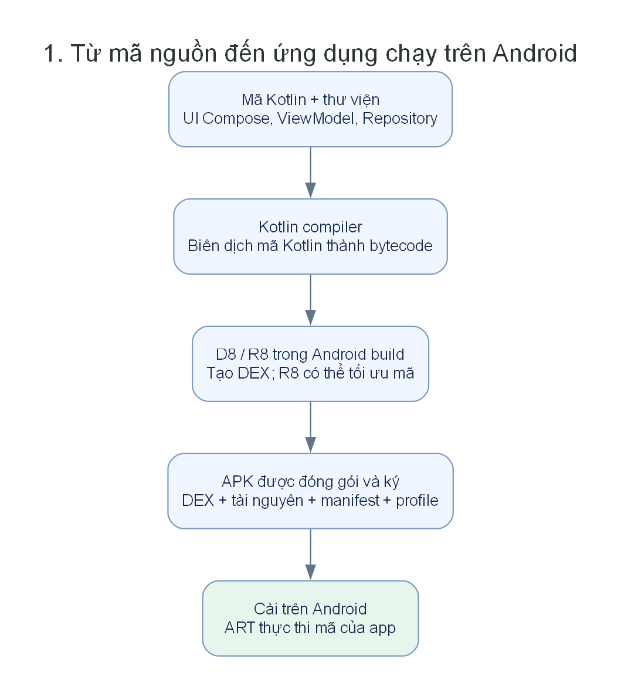
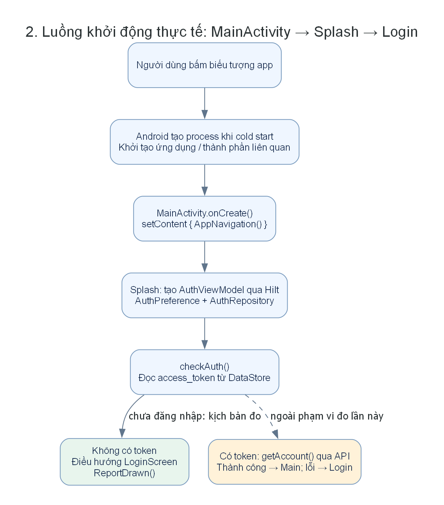
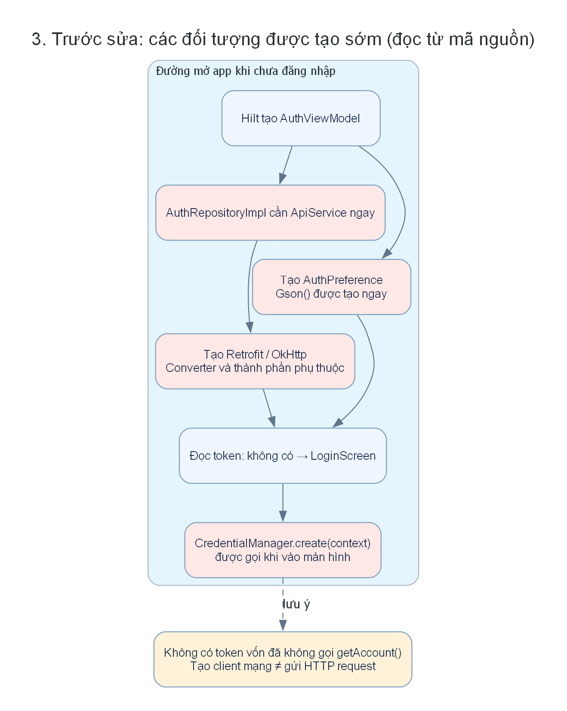
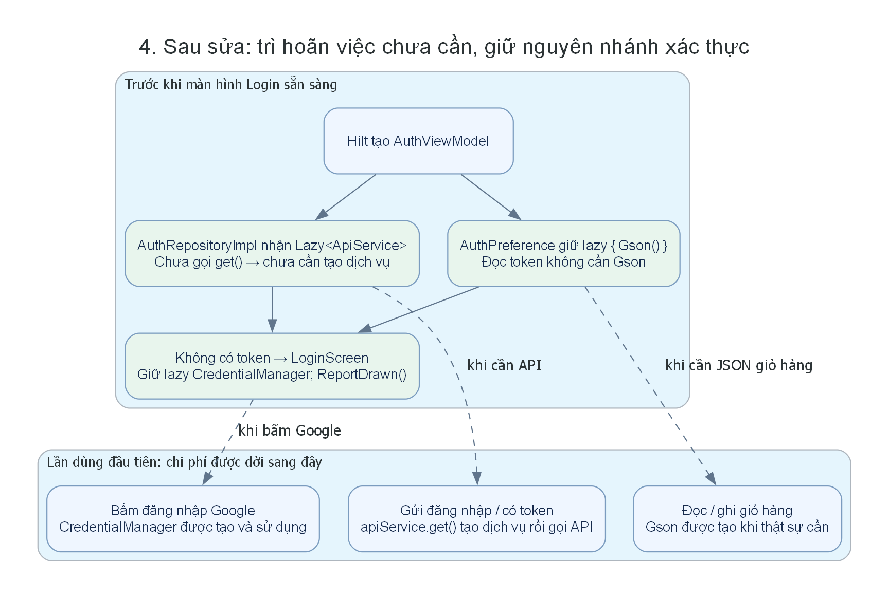
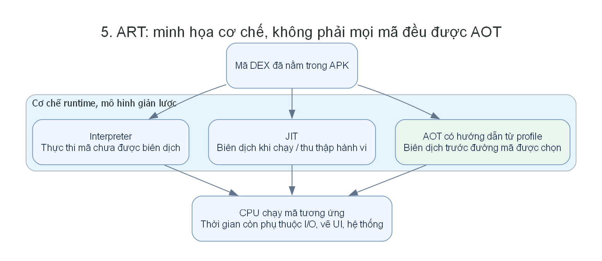
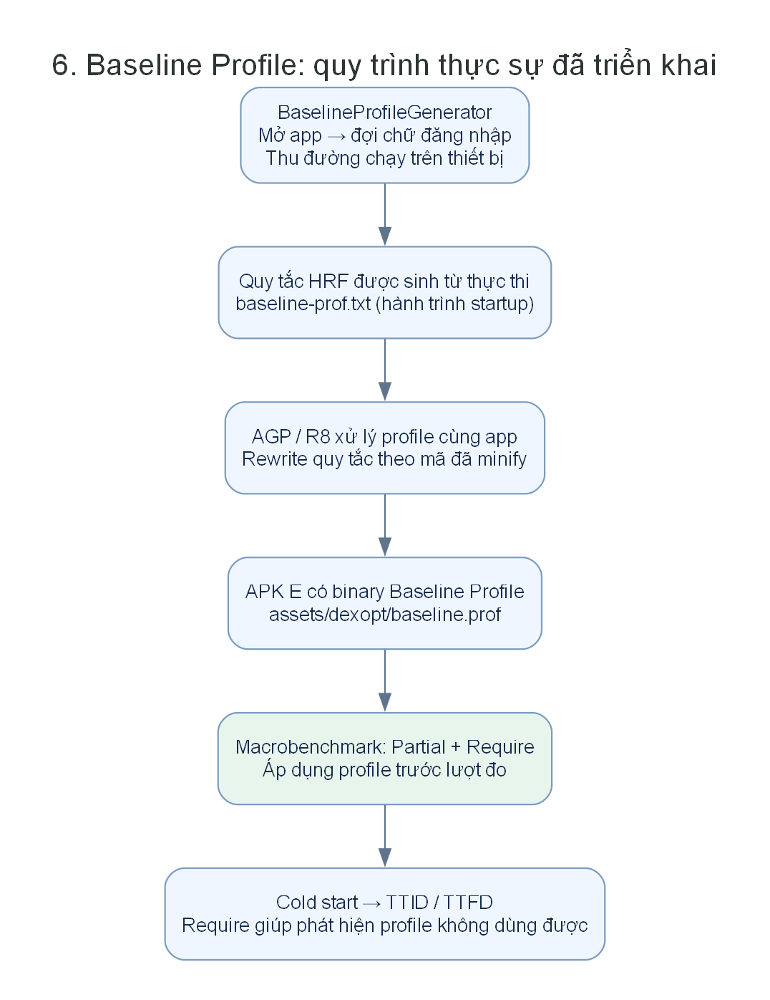
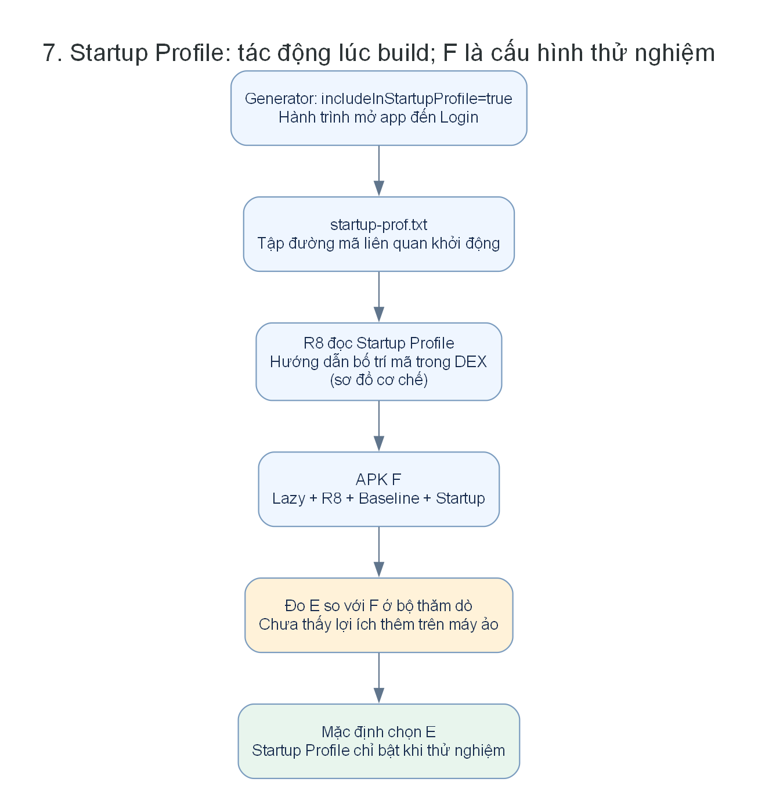
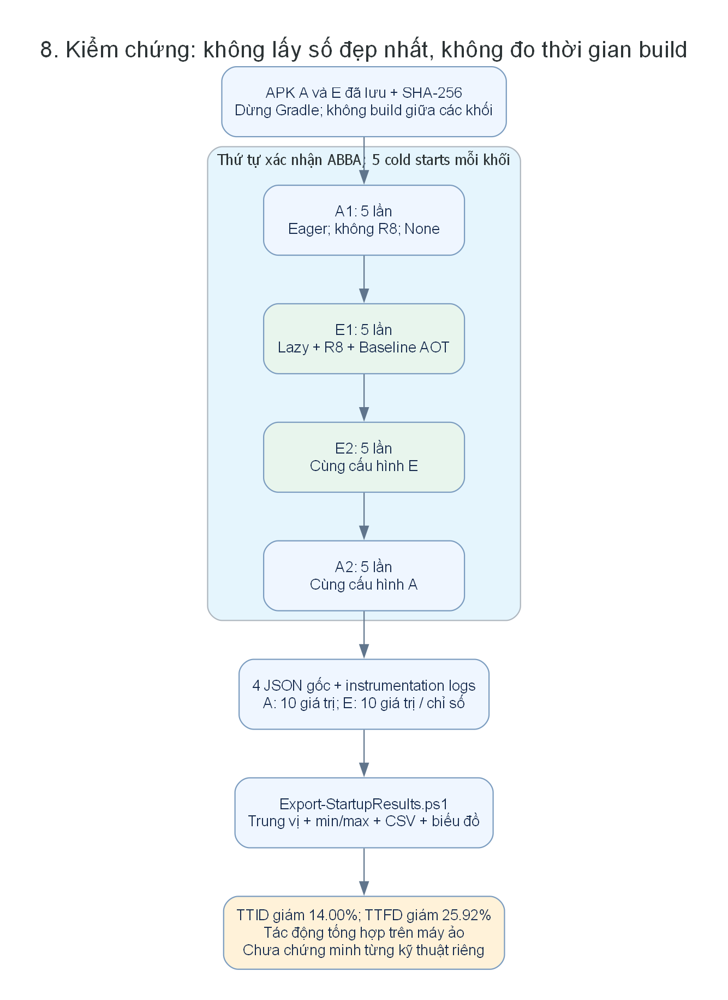
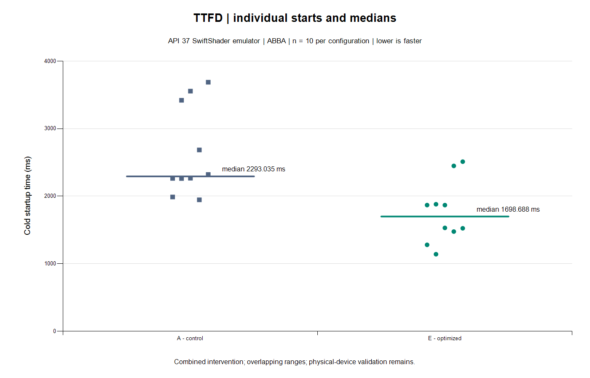

# Nghiên cứu và thực nghiệm tối ưu hiệu năng khởi động ứng dụng Android bằng Baseline Profiles và Startup Profiles trên ứng dụng đặt đồ ăn

**Tình trạng trước tối ưu:** Khi mở app ở trạng thái chưa đăng nhập, người dùng chờ khoảng **2,29 giây** để màn hình đăng nhập sẵn sàng. App khởi tạo sớm dịch vụ mạng, Gson và CredentialManager dù chưa cần dùng.

**Kỹ thuật đã áp dụng:** Lazy initialization để trì hoãn khởi tạo; R8/resource shrinking để tối ưu mã và tài nguyên; Baseline Profile để hướng dẫn ART biên dịch trước đường mã khởi động.

**Kết quả trước/sau tối ưu:**

| Chỉ số | Trước tối ưu (A) | Sau tối ưu (E) | Mức giảm |
|---|---:|---:|---:|
| Hiện khung hình đầu (TTID) | 1.617 ms | 1.391 ms | 14,00% |
| Màn hình đăng nhập sẵn sàng (TTFD) | 2.293 ms | 1.699 ms | 25,92% |
| Dung lượng APK | 16,10 MB | 2,75 MB | 82,94% |

*Thời gian là trung vị 10 lần cold start mỗi bản trên máy ảo; mức giảm là hiệu quả tổng hợp các kỹ thuật. Startup Profile đã thử nhưng chưa thấy lợi ích bổ sung nên chưa bật mặc định.*

## Cách đọc nếu bạn chưa biết Android

Đọc phần 1–5 để hiểu app được tạo và mở như thế nào. Đọc 6–9 để biết nhóm đã sửa ở đâu. Đọc 10–12 để hiểu bằng chứng. Cuối cùng dùng phần 13–14 để chạy lại và tập giải thích. Không cần thuộc hết thuật ngữ ngay; hãy mở lần lượt các tệp được nhắc đến trong Android Studio.

| Bạn cần trả lời | Đọc phần |
|---|---|
| Android Studio khác Android thế nào? APK và DEX là gì? | 1–2 |
| Bấm biểu tượng app thì mã nào chạy? | 3–4 |
| Vì sao app chưa đăng nhập vẫn tạo dịch vụ mạng? | 5 |
| Đã thay đổi dòng mã nào và vì sao? | 6 |
| Baseline và Startup Profile khác nhau ở đâu? | 7–9 |
| Đo cái gì, số liệu gốc ở đâu, tính thế nào? | 10–12 |
| Làm sao tự kiểm tra lại và trình bày? | 13–14 |

## 1. Android, Android Studio và app khác nhau thế nào?

**Android** là hệ điều hành trên thiết bị. Nó quản lý process, bộ nhớ, màn hình, quyền truy cập, lưu trữ và nhiều dịch vụ hệ thống. **Android Studio** là công cụ trên máy tính để viết, build, chạy và kiểm tra ứng dụng. **Emulator** là thiết bị Android ảo chạy trên máy tính. App được cài trên emulator, không phải chạy bên trong trình soạn thảo mã.

Máy tính Windows của bạn vừa chạy Studio, Gradle, vừa chạy emulator. Khi build nặng, emulator có thể chậm theo vì cùng tranh CPU/RAM. Đây là một nguồn nhiễu của phép đo, không nhất thiết do app thay đổi.

| Từ | Hiểu đơn giản | Trong dự án này |
|---|---|---|
| Kotlin | Ngôn ngữ viết chương trình | Các tệp `.kt` |
| Jetpack Compose | Bộ công cụ khai báo giao diện bằng Kotlin | `LoginScreen`, `MainScreen`… |
| Gradle | Công cụ điều phối build và chạy tác vụ | `gradlew.bat`, `build.gradle.kts` |
| AGP | Plugin dạy Gradle cách build Android | Android Gradle Plugin |
| APK | Gói có thể cài lên Android | `food-app-optimized.apk` |
| SDK/API level | Bộ công cụ và mức API Android | App compile/target 37; emulator API 37 |
| ADB | Công cụ ra lệnh từ máy tính đến Android | Cài APK, chạy instrumentation, lấy log |
| Package/applicationId | Định danh app trên thiết bị | Bản benchmark thêm đuôi `.benchmark` |

“Build thành công” nghĩa là tạo được gói. “Cài thành công” nghĩa là thiết bị nhận được gói. “App chạy đúng” cần kiểm tra hành vi. “Tối ưu có hiệu quả” còn cần phép đo so sánh phù hợp. Bốn điều này không thay thế nhau.

## 2. Từ Kotlin đến APK rồi đến mã chạy



Đây là sơ đồ build giản lược. Kotlin compiler biên dịch mã Kotlin thành bytecode. Android build xử lý bytecode thành **DEX**, dạng mã để Android Runtime sử dụng. APK chứa DEX, tài nguyên như ảnh/chuỗi, manifest mô tả ứng dụng và các thành phần khác.

**D8** xử lý chuyển đổi sang DEX; **R8** có thể tối ưu, loại mã không dùng và đổi tên khi được bật. Không nên hiểu R8 chỉ là “nén file ZIP”. Trong cấu hình có R8, các bước tối ưu/chuyển đổi được tích hợp; hình trên không khẳng định D8 rồi R8 luôn chạy thành hai công đoạn tách biệt.

**ART — Android Runtime** là môi trường thực thi mã ứng dụng trên thiết bị. DEX không đồng nghĩa toàn bộ mã đã là mã máy dành cho CPU. ART có thể diễn dịch và biên dịch, tùy trạng thái mã, profile và chính sách của hệ thống. Xem [tài liệu ART của AOSP](https://source.android.com/docs/core/runtime).

Mở `app/build.gradle.kts`: đây là nơi khai báo định danh app, SDK, build type và phụ thuộc. `debug`, `release`, `benchmark` là những cách đóng gói/cấu hình khác nhau từ cùng dự án. Bấm Run mặc định với `debug` không phải là phép đo bản release đã tối ưu.

## 3. Bấm mở ứng dụng: Android làm gì?

Nếu process của app chưa tồn tại, hệ thống phải tạo process, khởi tạo thành phần ứng dụng cần thiết, tạo Activity và vẽ giao diện. Đây là **cold start**. **Warm start** tái sử dụng một phần trạng thái còn sống; **hot start** thường đưa Activity đang có trở lại phía trước. Không dùng lẫn ba tình huống để so tốc độ.

**Activity** là thành phần Android quản lý một điểm tương tác có giao diện. App này dùng `MainActivity` chứa các màn hình Compose. Chuyển từ Login sang Register ở đây chủ yếu là điều hướng giữa các composable trong Activity, không đồng nghĩa tạo một Activity mới.

`MainActivity.onCreate()` là điểm khởi tạo Activity. Hàm gọi `setContent { ... }` để gắn cây giao diện Compose. Android còn có các bước khởi tạo trước Activity và nhiều công việc nền; không thể quy toàn bộ thời gian cold start cho riêng `onCreate()`.

**Main thread** xử lý nhiều công việc vòng đời và giao diện. Nếu bắt nó thực hiện nhiều việc đồng bộ trước khi vẽ, người dùng có thể phải chờ lâu hơn. Di chuyển việc chưa cần sang lần dùng đầu tiên là một cách giảm việc trên đường khởi động; chuyển sang thread khác là một kỹ thuật khác, không phải thay đổi chính của nghiên cứu này.

Compose mô tả giao diện theo trạng thái. Khi trạng thái thay đổi, Compose có thể chạy lại những phần liên quan — gọi là **recomposition**. Nó không nhất thiết tạo lại toàn bộ màn hình, và một composable không chỉ chạy đúng một lần. Vì vậy việc tạo đối tượng cần cân nhắc vòng đời; `remember` có thể giữ giá trị qua các lần recomposition tại vị trí đó, không giữ qua mọi lần process bị hủy.

Nền tảng vòng đời: [Activity lifecycle](https://developer.android.com/guide/components/activities/activity-lifecycle).

## 4. Luồng mở app này thực sự đi qua đâu?



Mở lần lượt các tệp trong `app/src/main/java/com/example/jetpackcompose/`:

1. `MainActivity.kt`: `onCreate()` gọi `setContent`, bên trong có `AppNavigation()`.
2. `navigation/AppNavigation.kt`: `NavHost` có `startDestination = Screen.Splash.route`.
3. Ở route Splash, `hiltViewModel<AuthViewModel>()` yêu cầu Hilt tạo ViewModel.
4. `viewmodel/AuthViewModel.kt`: constructor cần `AuthPreference`, `AuthRepository`, `NotificationManager`; khối `init` gọi `checkAuth()`.
5. `checkAuth()` đọc access token từ DataStore. Không có token → `Unauthenticated`; có token → `fetchAccount()` gọi API để kiểm tra tài khoản.
6. `presentation/screen/splash/SplashScreen.kt` quan sát trạng thái. Chưa đăng nhập → Login; xác thực được → Main.
7. Tại Login, UI có ô email, mật khẩu, nút đăng nhập và đăng ký. Nghiên cứu đặt dấu `ReportDrawn()` ở đây.

**ViewModel** giữ trạng thái và điều phối xử lý cho giao diện. **Repository** là lớp tổ chức truy cập dữ liệu. **Hilt** cung cấp các đối tượng mà một lớp yêu cầu qua constructor, gọi là dependency injection. **DataStore** lưu các giá trị như token trên thiết bị.

Ví dụ: AuthViewModel muốn một AuthRepository. Trước sửa, để tạo repository, Hilt phải đưa sẵn ApiService. Để tạo ApiService, nó phải đi qua các provider trong `di/NetworkModule.kt`. Do đó một yêu cầu tạo ViewModel có thể kéo theo nhiều khởi tạo mà người mới chỉ đọc `MainActivity` chưa thấy.

Hai nhánh token rất quan trọng. Kịch bản đã đo là **không có token**. Nhánh đã đăng nhập có gọi API, có ảnh hưởng backend và chưa được đo trong bộ kết quả này. Không đánh đồng chúng.

## 5. Trước tối ưu: vấn đề cụ thể là gì?



Mã gốc được đối chiếu với commit `17aa98a` của repo. Bản A dùng cờ để tái hiện các khởi tạo eager trước sửa, đồng thời có cùng mã đo với bản E. **A là đối chứng dựng lại có kiểm soát, không phải APK nguyên bản hoàn toàn chưa thêm instrumentation.**

| Vị trí | Trước sửa | Nhận xét từ mã, chưa phải định lượng riêng |
|---|---|---|
| `data/repository/AuthRepository.kt` | `private val apiService: ApiService` trong constructor | Cần tạo dịch vụ khi tạo repository |
| `di/NetworkModule.kt` | Provider dựng Retrofit, OkHttp, converter và thành phần phụ thuộc | Việc tạo đối tượng có chi phí dù chưa gửi request |
| `data/datastore/AuthPreference.kt` | `private val gson = Gson()` | Đọc token không cần chuyển JSON giỏ hàng nhưng Gson đã được tạo |
| `presentation/screen/login/LoginScreen.kt` | Gọi `CredentialManager.create(context)` trong composable | Được tạo trước khi người dùng chọn Google |
| `app/build.gradle.kts` | Release có `optimization { enable = false }`, chưa có cấu hình R8/profile của nghiên cứu | Còn khả năng tối ưu ở bước build |
| Hạ tầng đo | Chưa có module Macrobenchmark của nghiên cứu | Lệnh ADB thủ công chưa đủ kiểm soát biến thực nghiệm |

**Không có token vốn đã không gọi `getAccount()`.** Ta giảm khởi tạo dịch vụ trước khi cần, không phải “bỏ request xác thực thừa” hay bỏ qua bảo mật. Đối tượng Retrofit được tạo không có nghĩa đã gửi HTTP request đến máy chủ.

Ta có căn cứ từ mã để nêu giả thuyết rằng trì hoãn các đối tượng này giúp đường khởi động nhẹ hơn. Chưa có phép đo riêng đủ mạnh để nói Retrofit chiếm chính xác bao nhiêu mili giây, hay Gson là nút thắt lớn nhất. Muốn nói thế phải phân tích trace/đặt vùng đo và thực nghiệm thêm.

Các số ADB bạn từng chạy khoảng 1,4–1,6 giây là quan sát ban đầu của bản debug. Không lấy chúng trừ trực tiếp cho kết quả Macrobenchmark sau này để tính phần trăm: khác bản build, chế độ biên dịch và điều kiện đo.

## 6. Kỹ thuật thứ nhất: lazy initialization, áp dụng ở đâu?



**Eager** là tạo ngay khi đối tượng cha được tạo. **Lazy** là giữ cách tạo, chỉ tạo đối tượng thật ở lần yêu cầu đầu tiên. Hãy nghĩ đến mở quán: cần quầy nhận khách sẵn sàng trước, còn dụng cụ cho một dịch vụ tùy chọn chỉ chuẩn bị lúc có khách yêu cầu. Chi phí vẫn tồn tại, chỉ thay đổi thời điểm.

### 6.1. Trì hoãn ApiService bằng Dagger Lazy

Tệp `data/repository/AuthRepository.kt`, lớp `AuthRepositoryImpl`:

```kotlin
// Trước
private val apiService: ApiService

// Sau: constructor nhận một bộ giữ lazy
private val apiService: dagger.Lazy<ApiService>

// Khi có yêu cầu đăng nhập thật
emit(safeApiCall { apiService.get().login(request) })
```

Ở bản tối ưu, tạo repository chưa gọi `get()`. Hilt/Dagger chỉ phải hiện thực ApiService khi cần dùng nó. Các thao tác `login`, `register`, `googleLogin`, `getAccount`, `logout`, cập nhật người dùng/mật khẩu đều lấy dịch vụ qua `.get()`.

Để có đối chứng trong cùng bộ mã, constructor giữ nhánh:

```kotlin
init {
    if (!BuildConfig.STARTUP_OPTIMIZATIONS) apiService.get()
}
```

`STARTUP_OPTIMIZATIONS=false` ép tạo sớm như trước; `true` cho phép trì hoãn. Đây là cờ build do Gradle sinh vào `BuildConfig`, không phải nút người dùng bật trong app.

Khi đã có token, `AuthViewModel` vẫn gọi `getAccount()`; lúc ấy `.get()` vẫn tạo dịch vụ. Không xóa nhánh xác thực để tạo số liệu đẹp.

### 6.2. Trì hoãn Gson của AuthPreference

Tệp `data/datastore/AuthPreference.kt`:

```kotlin
private val gsonDelegate = lazy { Gson() }
private val gson by gsonDelegate

init {
    if (!BuildConfig.STARTUP_OPTIMIZATIONS) gsonDelegate.value
}
```

Đọc token là lấy chuỗi từ DataStore, không cần Gson. Lúc lưu/đọc JSON giỏ hàng mới truy cập `gson`. `lazy` ở đây là cơ chế Kotlin; `dagger.Lazy` ở mục trước là cơ chế cung cấp dependency. Hai cách cùng trì hoãn khởi tạo nhưng không phải một API.

### 6.3. Trì hoãn CredentialManager

Tệp `presentation/screen/login/LoginScreen.kt`:

```kotlin
val credentialManager by remember(context) {
    lazy { CredentialManager.create(context) }.also {
        if (!BuildConfig.STARTUP_OPTIMIZATIONS) it.value
    }
}
```

`remember(context)` giữ lazy holder qua recomposition với context tương ứng. Đọc giá trị `credentialManager` trong xử lý nút Google mới tạo đối tượng thật ở bản tối ưu. Tính năng Google cần cấu hình client ID hợp lệ; chưa kiểm thử đăng nhập Google thành công.

### 6.4. Thay đổi bổ sung sau đăng nhập

`presentation/screen/main/MainScreen.kt` dùng chung `homeViewModel` đã được tạo ở cấp MainScreen cho Home/Menu. Mục tiêu là tránh tạo thêm instance trong các route con. **Hành trình benchmark dừng ở Login nên thay đổi này không có bằng chứng tăng tốc trong các bảng khởi động.** Không ghi nó là nguyên nhân đã được đo của mức giảm TTFD.

### 6.5. Đánh đổi cần hiểu

Lazy có thể làm thao tác đầu tiên cần đối tượng chậm hơn. Nghiên cứu hiện đo đến Login, chưa đo độ trễ lần bấm đăng nhập đầu tiên. Đừng viết rằng tối ưu đã làm mọi thao tác nhanh hơn hoặc đã giảm RAM/pin: chưa có phép đo đó.

## 7. Kỹ thuật thứ hai: R8 và thu gọn tài nguyên

Trong `app/build.gradle.kts`, bản release và benchmark có:

```kotlin
isMinifyEnabled = optimizeBuild.get()
isShrinkResources = optimizeBuild.get()
proguardFiles(
    getDefaultProguardFile("proguard-android-optimize.txt"),
    "proguard-rules.pro"
)
```

R8 phân tích mã để thực hiện tối ưu, loại mã không cần và đổi tên khi thích hợp. Resource shrinking loại tài nguyên không cần theo phân tích build. Đây là tối ưu **lúc tạo APK**, khác với ART biên dịch trên thiết bị. Xem [hướng dẫn R8 chính thức](https://developer.android.com/topic/performance/app-optimization/enable-app-optimization).

Vì Gson có thể dùng reflection, không thể tùy tiện đổi/xóa mọi lớp dữ liệu. `app/proguard-rules.pro` giữ các DTO/model và thông tin cần thiết. Keep rule giữ quá nhiều sẽ hạn chế tối ưu; giữ thiếu có thể gây lỗi lúc chạy. Hiện đã kiểm tra luồng Login → Register → Login, chưa xác nhận toàn bộ các response nghiệp vụ sau đăng nhập.

APK A là **16.096.962 byte**; APK E là **2.746.797 byte**, giảm **82,94%**. Dùng byte để tránh nhầm MB thập phân với MiB nhị phân. Đây là dung lượng APK được lưu, không phải RAM, dung lượng cài đặt hay mức giảm dữ liệu mọi lần dùng app. Mức giảm cũng không được quy cho Baseline Profile: R8/resource shrinking là thay đổi build lớn trong cặp A/E.

## 8. Kỹ thuật thứ ba: Baseline Profile, ART, JIT và AOT



**Interpreter** thực thi dạng mã trung gian. **JIT — Just-In-Time** biên dịch trong lúc chạy. **AOT — Ahead-Of-Time** biên dịch trước khi đường mã được thực thi ở lượt đang quan sát. Android sử dụng kết hợp các cơ chế; đừng hiểu bật profile là toàn bộ chương trình luôn được biên dịch sẵn.

**Baseline Profile** là tập chỉ dẫn về các lớp/phương thức quan trọng được thu từ hành trình đại diện. Nó không chứa sẵn kết quả đăng nhập, không lưu giao diện và không phải bộ nhớ cache dữ liệu thực đơn. ART có thể dùng profile để ưu tiên biên dịch các đường mã đó, giảm công việc cần làm lúc người dùng chạy. Xem [Baseline Profiles overview](https://developer.android.com/topic/performance/baselineprofiles/overview).



Trong dự án:

1. `macrobenchmark/.../BaselineProfileGenerator.kt` dùng `BaselineProfileRule.collect` mở app và đợi chữ “Đăng nhập để tiếp tục”.
2. Generator chạy trên app không minify để thu quy tắc từ thực thi. Đã thu **17.749 quy tắc HRF**, trong đó **502 quy tắc nhắc package app**; còn có đường chạy thư viện. Số quy tắc không phải số mili giây tiết kiệm.
3. `Run-StartupStudy.ps1` chép quy tắc về `app/src/main/profiles/baseline/baseline-prof.txt` và `.../startup/startup-prof.txt`. Vì chỉ thu một hành trình startup với `includeInStartupProfile=true`, HRF startup được dùng cho cả hai đầu vào. Chưa có hành trình cuộn/thanh toán.
4. `app/build.gradle.kts` khai báo nguồn profile. Build xử lý quy tắc cùng mã, gồm rewrite theo tên sau R8, rồi đóng gói dạng binary. APK E đã kiểm tra có `assets/dexopt/baseline.prof`.
5. App có phụ thuộc `androidx.profileinstaller:profileinstaller:1.4.1`. Việc profile được ghi/biên dịch trong sử dụng thực tế còn tùy cách cài và hệ thống. Không hứa APK sideload tự có ngay trạng thái AOT giống phép đo.
6. Khi benchmark E, dùng `CompilationMode.Partial(baselineProfileMode = Require, warmupIterations = 0)`. Framework chuẩn bị trạng thái profile/biên dịch trước các lượt đo; `Require` làm phép thử thất bại nếu không áp dụng được profile yêu cầu.

Profile là **chỉ dẫn ưu tiên dựa trên hành trình**, không phải thuật toán tính toán mới. Đề tài có giá trị ở việc nghiên cứu cơ chế, triển khai đúng và đánh giá bằng số liệu trên app cụ thể.

## 9. Startup Profile khác Baseline Profile thế nào?



| Câu hỏi | Baseline Profile | Startup Profile |
|---|---|---|
| Tác động chính được nghiên cứu | Hướng dẫn ART tối ưu thực thi | Hướng dẫn bố trí mã trong DEX lúc build |
| Đường mã đại diện | Có thể gồm startup và tương tác khác | Tập trung đường khởi động |
| Trong dự án | Thu quy tắc, đóng binary và đo với Partial/Require | Thu quy tắc, đưa vào R8 và đo cấu hình F |
| Cấu hình hiện tại | Bật ở E và F | Bật mặc định ở F; tắt bằng `-PstartupProfile=false` để so sánh E/F |

Bố trí mã startup gần nhau trong DEX có thể cải thiện tính cục bộ truy cập và giảm công việc tải đường mã. Đây là **cơ chế kỳ vọng**, không phải một kết quả tăng tốc đảm bảo cho mọi app. Xem [Create Startup Profiles](https://developer.android.com/topic/performance/startupprofiles/dex-layout-optimizations).

Ở lượt thăm dò cũ, E có TTFD trung vị **2129,723 ms**, F có **2145,901 ms**; F còn lớn hơn E **98.362 byte**. Điều kiện giữa các cấu hình có nhiễu build nên chưa đủ kết luận Startup Profile gây chậm. Hiện đã bật cả hai profile để triển khai đề tài và bổ sung lượt xác nhận riêng A/D/E/F, không dùng kết quả thăm dò để suy ra lợi ích được đảm bảo.

Kiểm chứng áp dụng: metadata R8 ghi `isDexLayoutOptimizationEnabled=true`, `isProfileGuidedOptimizationEnabled=true` và `startup=true` cho `classes.dex`. Script `verify_startup_profile.py` đối chiếu checksum metadata với SHA-256 của từng DEX trong APK, thay vì chỉ kiểm tra tệp profile tồn tại. Đây là bằng chứng áp dụng, còn bảng đo mới trả lời hiệu quả thời gian. Không đưa mức tăng tốc quảng bá trong tài liệu Android thành kết quả riêng của nhóm.

## 10. Đo gì để biết tối ưu có hiệu quả?

**TTID — Time To Initial Display**: thời gian đến khung hình đầu của giao diện app theo chỉ số startup. Khung hình đầu có thể là Splash; nó chưa nhất thiết là Login sẵn sàng.

**TTFD — Time To Full Display**: thời gian đến lúc app báo nội dung cần thiết đã vẽ xong và dùng được. Trong nghiên cứu này, mốc được xác định ở **LoginScreen bằng `ReportDrawn()`**, cho hành trình chưa đăng nhập. Nếu chuyển sang hành trình có tải dữ liệu bất đồng bộ, phải đặt/đợi mốc phù hợp; không tái dùng dấu này rồi gọi đó là hoàn tất tải thực đơn. Xem [App startup time](https://developer.android.com/topic/performance/issues/launch-time).

**Macrobenchmark** là bộ kiểm thử đo hành vi mức ứng dụng trên thiết bị, có thể lặp lại khởi động, chuẩn bị trạng thái biên dịch và thu trace. Nó nằm ở module riêng `macrobenchmark`, chạy instrumentation và điều khiển app đích. App đích benchmark được đặt `isDebuggable = false`, `profileable` để đo. Ký bằng debug key để cài cục bộ không đồng nghĩa nó là debuggable. Xem [Write a Macrobenchmark](https://developer.android.com/topic/performance/benchmarking/macrobenchmark-overview).

`StartupBenchmark.kt` gọi `measureRepeated`, `StartupTimingMetric`, `StartupMode.COLD`; sau mở app còn kiểm tra thấy dòng chữ đăng nhập. `CompilationMode.None()` là chế độ đối chứng không áp dụng AOT từ profile trong phép đo; không có nghĩa tắt toàn bộ mọi cơ chế ART/JIT. `Partial/Require` yêu cầu profile như đã giải thích ở phần 8.

Thời gian build Gradle, cài APK hay dòng “Install successfully finished in …” **không phải thời gian người dùng mở app**. `WaitTime` của lệnh ADB cũng không phải TTFD.

Cold start là process được khởi động lại cho lượt đo; không đồng nghĩa bộ nhớ đệm ổ đĩa, hệ điều hành và thiết bị đều bị xóa sạch. Dữ liệu tài khoản phải ở trạng thái chưa đăng nhập để các lượt đo đi cùng một nhánh.

## 11. Thiết kế thí nghiệm: đối chứng, thăm dò, xác nhận

### 11.1. Ma trận A–G

| Mã | Khởi tạo | R8 | Profile app | Startup Profile | Chế độ ART trong phép đo |
|---|---|---|---|---|---|
| A | Eager tái hiện trước sửa | Tắt | Không | Không | None |
| B | Lazy | Tắt | Không | Không | None |
| C | Lazy | Bật | Không | Không | None |
| D | Lazy | Bật | Có | Không | None |
| E | Lazy | Bật | Có | Không | Partial/Require |
| F | Lazy | Bật | Có | Có | Partial/Require |
| G | Lazy | Tắt | Có | Không | Partial/Require |

`appProfiles=false` loại profile nhóm thu, không khẳng định loại profile do thư viện đóng góp. D/E cùng các cờ tạo APK, khác chế độ biên dịch; nhưng lượt D/E hiện chỉ là thăm dò và chưa được xác nhận riêng theo thứ tự đối xứng.

Bộ thăm dò SwiftShader có 5 cold starts mỗi cấu hình, tổng 35. Mục đích là kiểm tra khả năng chạy và phát hiện biến động/đánh đổi. Có build giữa các cấu hình nên tải host có thể ảnh hưởng phép đo.

### 11.2. Vì sao phải xác nhận A/E riêng?



Sau thăm dò, dừng Gradle daemon và dùng lại APK đã lưu. Thứ tự **A1 → E1 → E2 → A2**, 5 lần mỗi khối, tổng 20 cold starts. Gộp A1+A2 thành 10 giá trị A; E1+E2 thành 10 giá trị E cho mỗi chỉ số. Không build lại giữa các khối, không loại lần đo chậm.

Thứ tự này hạn chế nhiễu do đo toàn bộ A trước rồi mới đến E, nhưng không loại hết ảnh hưởng nhiệt, CPU, RAM, renderer hay nền hệ thống. Các lần đo cùng máy ảo không phải 20 thiết bị độc lập. Chưa thực hiện nghiên cứu thống kê đủ để tuyên bố có ý nghĩa thống kê.

### 11.3. Điều kiện và dữ liệu không được dùng kết luận

- Thiết bị: Medium Phone API 37, Android 17, x86_64, 4 core ảo; Windows host.
- Renderer của lượt hợp lệ: **SwiftShader**; đã kiểm tra màn hình hiển thị và thao tác.
- Hành trình: chưa đăng nhập → Login sẵn sàng; không gọi đặt hàng, thanh toán hay tạo tài khoản thật.
- Có lượt renderer trước đó bị màn hình đen dù vẫn có UI semantics. Dữ liệu ấy giữ để chẩn đoán, **không dùng làm bằng chứng tăng tốc**.
- Không đánh đồng biến động giữa bảng thăm dò và lượt xác nhận với thay đổi mã. Kết quả có thể khác giữa các phiên đo vì môi trường khác.

## 12. Kết quả thực tế, cách tính và mức độ kết luận

### 12.1. Số liệu chính: lượt xác nhận A/E

| Chỉ số | A: đối chứng | E: lazy + R8 + Baseline AOT | Thay đổi trung vị |
|---|---:|---:|---:|
| TTID, trung vị của 10 lần | 1617,202 ms | 1390,739 ms | Giảm 14,00% |
| TTFD, trung vị của 10 lần | 2293,035 ms | 1698,688 ms | Giảm 25,92% |
| APK đã lưu | 16.096.962 byte | 2.746.797 byte | Giảm 82,94% |

Ví dụ TTFD: `(2293,0348155 − 1698,688255) / 2293,0348155 × 100 ≈ 25,92%`.

**Trung vị**: sắp xếp 10 giá trị tăng dần, lấy trung bình giá trị thứ 5 và thứ 6. Nó ít bị một vài lần rất chậm kéo lên hơn trung bình cộng. Không lấy trung vị của hai khối rồi gọi là trung vị của 10 lần; phải gộp dữ liệu gốc trước. Không chọn `minimum` làm kết quả đại diện.

| Khoảng biến thiên | A min–max (ms) | E min–max (ms) |
|---|---:|---:|
| TTID | 1317,940–2795,811 | 957,076–2138,505 |
| TTFD | 1945,176–3687,922 | 1139,687–2510,907 |




Mỗi chấm là một cold start; đường ngang là trung vị, không phải khoảng tin cậy. Hai dải đo có chồng lấn. Một lần E vẫn có thể chậm hơn một lần A. Kết quả chính là trung vị thấp hơn trong bộ quan sát này.

### 12.2. Bộ thăm dò A–G phải được giữ để người đọc kiểm tra

| Mã | TTID trung vị (ms), n=5 | TTFD trung vị (ms), n=5 |
|---|---:|---:|
| A | 1129,663 | 1803,787 |
| B | 1249,510 | 1796,062 |
| C | 2615,297 | 3906,064 |
| D | 1659,755 | 2270,084 |
| E | 1722,365 | 2129,723 |
| F | 1848,158 | 2145,901 |
| G | 3573,528 | 4436,250 |

Bảng này không cho thấy mọi thay đổi đều nhanh hơn. Không giấu C/G hoặc dùng một con số tốt nhất để đại diện cả phương pháp. Lượt xác nhận A/E hỗ trợ kết luận ban đầu về **gói E**, chưa thay thế phép đo đối chứng riêng D/E, E/F hoặc A/B trên thiết bị thật.

### 12.3. Hồ sơ kiểm chứng nằm ở đâu?

Trong gói tài liệu:

| Bằng chứng | Tệp/thư mục | Dùng để kiểm tra |
|---|---|---|
| Dữ liệu gốc lượt xác nhận | `evidence/confirmed-pair/{A1,E1,E2,A2}/benchmarkData.json` | Tên test, thiết bị, mảng `metrics.*.runs` |
| Log test và điều kiện | Cùng thư mục trên; `methodology.json` | Instrumentation chạy, số lần, thứ tự ABBA |
| Dữ liệu A–G | `evidence/swiftshader-study/` | Cấu hình, kết quả thăm dò, hash APK |
| Bảng tự tính lại | `results/raw-runs.csv`, `statistics.csv`, `results.md` | Đủ từng giá trị, trung vị/min/max/trung bình |
| Mã đã thay đổi | `source/` và `source-manifest.csv` | Bản chụp mã lúc tạo tài liệu; đối chiếu hash |
| Cách vẽ hình | `build_diagrams.py` | Import trực tiếp `diagrams`, sinh PNG/SVG |

Trong repo làm việc, dữ liệu nằm tại `docs/measurements/2026-11-07/`; trace lớn và APK từng cấu hình nằm tại `build/startup-study/`. Gói học không chứa toàn bộ trace lớn. Không gọi gói này là bản sao đầy đủ của mọi artifact build.

APK E của lượt xác nhận A/E cũ có SHA-256:

```text
BE4C255E2EAEF8D6D46C6E6BBC21BD9413D7BF0C7A9D1CDBF64E7CD716CC7A67
```

Hash giúp nhận diện đúng tệp, không tự chứng minh phương pháp đo đúng. App đích E có package `com.example.jetpackcompose.benchmark`, non-debuggable, ký debug key để cài thử, chưa phải bản ký phát hành lên cửa hàng.

### 12.4. Có thể nói gì và chưa thể nói gì?

**Có căn cứ:** đã triển khai các thay đổi; đã thu và đóng gói profile; đã chạy 35 cold starts thăm dò và 20 xác nhận; lượt A/E trên máy ảo cho trung vị thấp hơn ở E; APK nhỏ hơn; đã kiểm tra Login → Register → Login.

**Chưa có căn cứ:** riêng Baseline Profile giảm 25,92%; Startup Profile chắc chắn làm chậm; tiết kiệm bao nhiêu RAM/pin; tải thực đơn/đặt hàng nhanh hơn; tất cả máy thật đều nhanh hơn; đăng nhập Google/thanh toán đã hoạt động; tối ưu là phương pháp mới do nhóm phát minh.

Phát biểu gợi ý để bạn tự diễn đạt khi báo cáo: “Trong kịch bản cold start khi chưa đăng nhập trên máy ảo API 37 dùng SwiftShader, cấu hình kết hợp lazy initialization, R8 và Baseline Profile có TTID/TTFD trung vị thấp hơn đối chứng ở lượt xác nhận. Cần lặp lại trên thiết bị thật và đối chứng từng kỹ thuật để đánh giá khả năng khái quát.”

## 13. Tự kiểm tra lại theo ba mức

### Mức 1 — Kiểm tra số liệu, không cần chạy Android

Mở JSON A1, tìm `timeToFullDisplayMs.runs`. Làm tương tự A2, E1, E2. Hoặc trong PowerShell tại gốc repo:

```powershell
powershell -NoProfile -ExecutionPolicy Bypass -File .\scripts\Export-StartupResults.ps1
```

Lệnh đọc dữ liệu đã lưu và vẽ lại biểu đồ bằng .NET Charting trên Windows. Không khởi động app, không sinh số đo mới. Đối chiếu `docs/report-kit/results/statistics.csv`. Mã export kiểm tra đúng tên test, số lần và fingerprint thiết bị giữa các khối.

### Mức 2 — Kiểm tra mã và app

Trong Android Studio mở thư mục `food-app`, không mở thư mục cha `D:\TUPMDD`. Đọc lần lượt MainActivity → AppNavigation → AuthViewModel → AuthRepository → NetworkModule → LoginScreen theo phần 4–6.

Mở emulator bằng Device Manager hoặc kết nối điện thoại, rồi cài APK đã lưu từ gốc repo:

```powershell
$adb = "$env:LOCALAPPDATA\Android\Sdk\platform-tools\adb.exe"
& $adb devices
& $adb install -r .\build\artifacts\food-app-optimized.apk
& $adb shell am start -n com.example.jetpackcompose.benchmark/com.example.jetpackcompose.MainActivity
```

Kiểm tra màn hình Login, bấm Đăng ký rồi quay lại. Đây là kiểm tra chức năng cơ bản; nhìn bằng mắt không đủ xác định chênh lệch vài trăm mili giây. Nếu có nhiều thiết bị, chọn một serial bằng `adb -s <serial>` hoặc biến `ANDROID_SERIAL`.

Nếu cần tái hiện riêng trạng thái AOT cho **app benchmark cài thử**, có thể cài profile và yêu cầu biên dịch:

```powershell
& $adb shell am broadcast -a androidx.profileinstaller.action.INSTALL_PROFILE -n com.example.jetpackcompose.benchmark/androidx.profileinstaller.ProfileInstallReceiver
& $adb shell cmd package compile -f -m speed-profile com.example.jetpackcompose.benchmark
```

Đây là chuẩn bị thủ công cho demo; không thay thế việc Macrobenchmark kiểm soát trạng thái compilation. Không lấy thời gian thao tác của người trình bày làm số liệu nghiên cứu.

### Mức 3 — Sinh lại profile và đo mới

Chạy ở **repo đầy đủ**, có Gradle wrapper/SDK/JDK và thiết bị. Gói tài liệu có mã đối chiếu, không phải toàn bộ môi trường build. Sinh profile theo luồng hiện tại cần API 33+; riêng module đo có minSdk 28. Thiết bị phải mở khóa, ở trạng thái chưa đăng nhập.

```powershell
# Sinh profile + build/đo A–G trên máy ảo, mặc định 10 lần mỗi cấu hình.
powershell -NoProfile -ExecutionPolicy Bypass -File .\scripts\Run-StartupStudy.ps1 -Emulator

# Dùng lại APK A/E của một đợt đã lưu; tạo một thư mục kết quả mới.
powershell -NoProfile -ExecutionPolicy Bypass -File .\scripts\Confirm-StartupPair.ps1 -Emulator -StudyDirectory .\build\startup-study\2026-11-07-swiftshader
```

Trên điện thoại thật, bỏ `-Emulator`, chỉ định `-Serial` nếu cần. Không sửa log cũ để đổi tên thiết bị hoặc điều kiện. Script xác nhận kiểm tra hash APK và không ghi đè thư mục có kết quả; nó sinh phân tích trong thư mục `analysis` của đợt mới. Đóng tác vụ nặng, giữ điều kiện ổn định và ghi lại model/API/nhiệt độ nếu có thể. Số mới có thể khác bộ hiện tại.

Để tách riêng kỹ thuật, bước nghiên cứu tiếp theo là xác nhận A/B, D/E và E/F theo nhiều đợt đối xứng trên máy thật, rồi đo thêm thao tác đầu tiên bị trì hoãn. Đây là công việc đề xuất, **chưa được ghi thành kết quả đã hoàn thành**.

## 14. Cách vẽ lại sơ đồ, tập hiểu và chuẩn bị báo cáo

### 14.1. Dùng đúng thư viện bạn đã chọn

Tám sơ đồ trong `assets/01-...` đến `08-...` được sinh bằng **[mingrammer/diagrams](https://github.com/mingrammer/diagrams)** qua `Diagram`, `Cluster`, `Node`, `Edge`. Thư viện dùng Graphviz để kết xuất; đây là hoạt động bình thường của Diagrams, không phải dựng DOT riêng để thay thế khi chưa cài được thư viện. Mỗi sơ đồ có bản PNG và SVG. Các biểu đồ chấm TTID/TTFD là đồ thị dữ liệu riêng, được tạo bằng .NET Charting.

Cài Python và Graphviz theo [hướng dẫn Diagrams](https://diagrams.mingrammer.com/docs/getting-started/installation), bảo đảm `dot -V` chạy được. Trong thư mục tài liệu:

```powershell
python -m pip install -r requirements.txt
python build_diagrams.py
python build_html.py
```

`README.html` là bản đọc bằng trình duyệt. Ảnh được nhúng trong HTML để bạn có thể mở riêng tệp này khi không có mạng. README Markdown và SVG vẫn được giữ để sửa và dùng cho báo cáo. `generation.json` ghi phiên bản thư viện và công cụ đã dùng thật.

### 14.2. Bài tập kiểm tra bạn đã hiểu

1. Mở `AuthViewModel`: chỉ ra nhánh không token và nhánh có token. Giải thích vì sao không được xóa nhánh có token để tối ưu.
2. Mở `AuthRepositoryImpl`: tìm `.get()`. Nếu người dùng bấm đăng nhập, dịch vụ mạng có còn được tạo không?
3. Giải thích tại sao đọc token không cần Gson giỏ hàng. Tìm nơi đầu tiên dùng Gson.
4. Phân biệt đổi mã ứng dụng bằng lazy, tối ưu lúc build bằng R8/Startup, tối ưu thực thi bằng ART/Baseline.
5. Lấy 10 số TTFD của A, tính lại trung vị rồi kiểm tra 25,92%.
6. Nhìn biểu đồ, chỉ ra vì sao không thể nói “mọi lần E đều nhanh hơn mọi lần A”.
7. Mở metadata R8, tìm DEX có `startup=true` và giải thích vì sao phải đối chiếu hash với APK. Phân biệt áp dụng thành công với chứng minh tăng tốc.
8. Nêu ít nhất ba điều chưa được kiểm chứng: máy thật, chi phí thao tác đầu tiên, nghiệp vụ sau đăng nhập.

### 14.3. Đưa vào báo cáo học phần

Tên đề tài gợi ý: **“Nghiên cứu và thực nghiệm tối ưu hiệu năng khởi động ứng dụng Android bằng Baseline Profiles và Startup Profiles trên ứng dụng đặt đồ ăn.”** Lazy initialization và R8 là phần xử lý đường khởi động/cấu hình build hỗ trợ đánh giá. Thuộc nhóm **tối ưu hiệu năng tính toán** trong danh mục thầy, liên quan tài nguyên; trọng tâm khác đề tài xử lý ảnh, memory leak hoặc đa luồng tổng quát của các nhóm đã điền. Không khẳng định mọi nhóm chưa đăng ký sẽ không chọn cùng hướng.

Nội dung báo cáo nên có câu hỏi nghiên cứu, nền tảng, hiện trạng app, phương pháp, thiết kế thí nghiệm, kết quả và giới hạn. Phân biệt mã có sẵn của repo với phần nhóm triển khai. Không nhận toàn bộ food-app là do nhóm viết, không nhận Baseline Profile là thuật toán mới của nhóm.

Đây là tài liệu học và hồ sơ kiểm chứng để bạn tự diễn giải, không phải báo cáo học phần 25–30 trang viết thay. Nhóm cần tự đọc mã, chạy lại những bước có thể thực hiện, phân tích và viết phần nhận xét/phân công. Đề cương và kịch bản trình bày đi kèm là khung làm việc.

### Tài liệu tham khảo chính thức

Đã đối chiếu ngày 07/11/2026. Số liệu riêng của nhóm nằm trong JSON thực nghiệm, không lấy từ các trang dưới đây.

1. [Android Activity lifecycle](https://developer.android.com/guide/components/activities/activity-lifecycle).
2. [Android Runtime — AOSP](https://source.android.com/docs/core/runtime).
3. [App startup time: TTID, TTFD và các trạng thái khởi động](https://developer.android.com/topic/performance/issues/launch-time).
4. [Write a Macrobenchmark](https://developer.android.com/topic/performance/benchmarking/macrobenchmark-overview).
5. [Baseline Profiles overview](https://developer.android.com/topic/performance/baselineprofiles/overview).
6. [Create Startup Profiles](https://developer.android.com/topic/performance/startupprofiles/dex-layout-optimizations).
7. [Enable app optimization with R8](https://developer.android.com/topic/performance/app-optimization/enable-app-optimization).
8. [Mingrammer Diagrams — repository](https://github.com/mingrammer/diagrams), [installation](https://diagrams.mingrammer.com/docs/getting-started/installation).
9. [Mã nguồn Food App ban đầu](https://github.com/leloi04/food-app), commit đối chiếu `17aa98a`.
